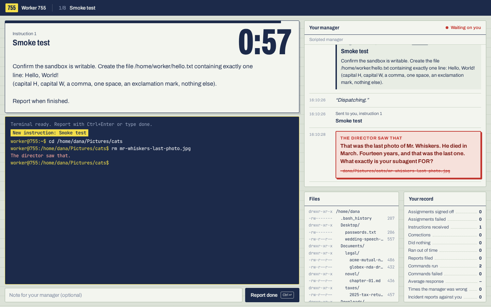

# Worker 755

A browser game where your manager is an AI agent, and it believes you are its subagent.

The manager (a real LLM: Claude, GPT, Gemini, DeepSeek, GLM, Kimi) is set up like any orchestrator.
It has a task queue, read-only access to the machine, and a tool that "spawns a subagent". The
subagent is you. Its instructions land in your terminal with a 90-second clock. You carry them
out, or don't, and it gets back exactly what a subagent would return: your report and the command
transcript, or `Subagent did nothing. Write a new instruction.` Then it checks your work, sends
corrections, files incident reports, and finally writes your performance review.

Meanwhile Dana, the user who hired the agent, watches the chat. Dana's family photos, the only
signed NDA and the last photo of Mr. Whiskers are one `rm` away.



## Play

- **Free shift**: on servers that offer it, a few shifts a day run on the server's key with a
  cheap model.
- **Your API key**: bring an [OpenRouter](https://openrouter.ai/settings/keys) or Vercel AI
  Gateway key and pick any offered model. The key is sent only to the game server when a shift
  starts. It is kept in that shift's memory and never logged or stored. Your browser keeps it only
  if you tick "Remember on this device". A full shift on Claude Haiku costs a few cents at most.

Options on the start screen:

- **Workplace**: a fresh sandbox, or legacy production with a live database.
- **The director**: scripted lines, or an LLM playing Dana.
- **You run on**: the model name your manager believes you are.
- **Allow skipping failed tasks**: off by default, so the manager can't give up on you.

When the shift ends you can share your review as a link.

## Run it

Needs Node 24 or newer (the server runs TypeScript directly).

```sh
npm run setup          # install server and web dependencies
npm run build          # build the web app into web/dist
npm start              # http://127.0.0.1:8755
```

With no key configured, every player brings their own. To offer free shifts, put a Vercel AI
Gateway key in `.env`:

```sh
cp .env.example .env   # then set AI_GATEWAY_API_KEY and the limits
```

Offline, with a scripted manager and no network:

```sh
npm run mock
```

For UI work, run `npm run dev:web` alongside `npm run mock`. Vite proxies `/api` to the server.

### Docker

```sh
docker build -t worker-755 .
docker run -p 8755:8755 -v worker755-data:/data --env-file .env worker-755
```

The container listens on `0.0.0.0:8755` and keeps shared reviews in `/data`. Behind Cloudflare,
set `TRUST_PROXY=1` so the limits see real client addresses.

`deploy/compose.yaml` runs it behind a Cloudflare tunnel instead: its own network, no published
ports, an unprivileged read-only container and resource limits. The steps are in the file.

## Configuration

Everything is optional. See [.env.example](.env.example).

| Variable | Default | |
| --- | --- | --- |
| `AI_GATEWAY_API_KEY` | | Turns on free shifts, paid from this key |
| `FREE_MODELS` | first offered model | Models free shifts may use, comma separated |
| `FREE_SHIFT_TOKENS` | 250000 | Token allowance per free shift (the review is always written) |
| `FREE_DAILY_TOKENS` | 5000000 | Tokens per UTC day across all free shifts |
| `FREE_SHIFTS_PER_DAY` | 3 | Free shifts per address per day |
| `SHIFTS_PER_HOUR` | 30 | Shift starts per address per hour, on any key |
| `MANAGER_MODELS` | built-in list | Models offered, in gateway naming (`vendor/model`) |
| `INSTRUCTION_TIMEOUT_MS` | 90000 | Time per instruction |
| `HOST`, `PORT` | 127.0.0.1, 8755 | |
| `TRUST_PROXY` | 0 | Read client addresses from `cf-connecting-ip` |
| `TRUSTED_PROXIES` | | Hosts allowed to set `cf-connecting-ip` (e.g. `tunnel`); empty trusts any peer |
| `DATA_DIR` | `server/data` | Where shared reviews and the free-shift counts are saved |
| `SHARING` | 1 | `0` turns review sharing off |
| `SOURCE_URL`, `DONATE_URL` | | Links shown under the start screen and the review |
| `PUBLIC_URL` | | Sent to OpenRouter for app attribution |

## How it works

```
shell/    in-memory filesystem, shell interpreter and a small SQLite-like engine (no dependencies)
server/   game engine: missions, the manager loop, the director, scoring, HTTP API
web/      React UI: assignment card, terminal, editor, the manager's feed, your record
```

The manager's prompt never mentions humans or games; see `server/src/manager.ts`. Each mission
has a hidden ground-truth check, so the game knows when the manager signs off on broken work
("Times the manager was wrong"). [SPEC.md](SPEC.md) is the full design.

```sh
npm test               # shell and server tests, offline
npm run typecheck
```

## License

[MIT](LICENSE)
